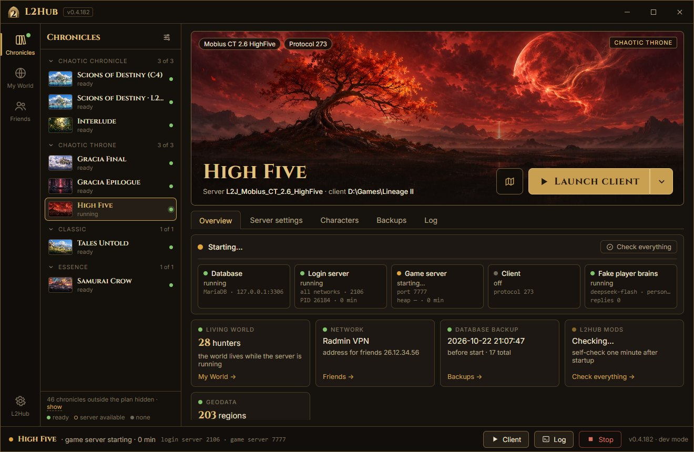
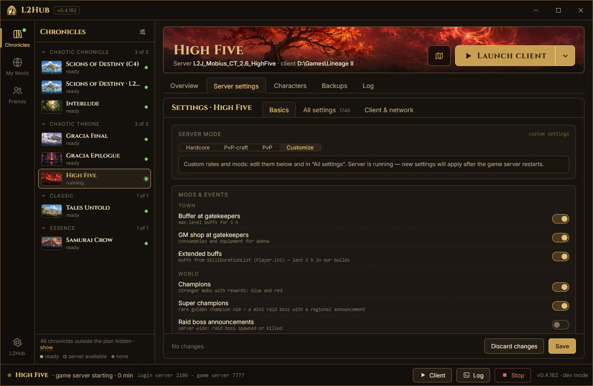
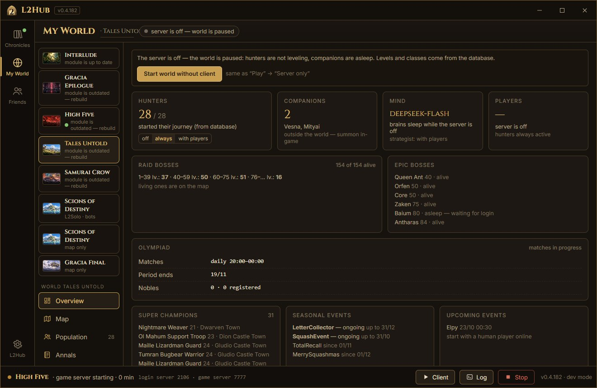

# L2Hub

[Русский](README.md) · **English**

**L2Hub is your own Lineage II server on your PC, one button away.** Pick a chronicle, click “Install”, then “Play”: L2Hub downloads the server, builds it, sets up the database and launches your game client. Play alone in a living world or with friends.

> **Disclaimer.** L2Hub is a fan-made tool for local play. It is not affiliated with NCSoft, contains and distributes no game clients or NCSoft files, runs no public servers and sells nothing. Lineage II and the chronicle names are trademarks of NCSoft Corporation.

## What's inside

- **Chronicles in one click.** Interlude, Gracia Epilogue, High Five, Classic (Tales Untold), Essence (Samurai Crow) run on [L2J Mobius](https://gitlab.com/MobiusDevelopment/L2J_Mobius) with our mods; C4 runs on [L2Solo](https://github.com/pmbstyle/L2Solo) with its 1,700 bots. About thirty more Mobius chronicles install as is, without mods. You can also connect your own server build (L2J on Java, or a bundle with its own database).
- **A living world for one.** Phantom hunters grow along with you: they level on spots, form parties, trade in Giran, raid bosses, join PvP events, the Olympiad and the Seven Signs, and challenge you to duels. Companions join your party (`.buddy`). You can actually talk to the bots: their “brains” run on an LLM if you plug in your own key (DeepSeek or any OpenAI-compatible API) or your own model (LM Studio, Ollama).
- **Solo-friendly mods.** A buffer and a GM shop next to gatekeepers, champions and rare super champions, daily tasks (`.daily`), seasonal events all year round, “World now” (`.world`) and the Alt+B board. The Olympiad, the Seven Signs and the epic bosses are tuned for a small world: one player plus the hunters is enough. Every mod can be switched off.
- **Server modes.** “Hardcore” (x1, like retail, no conveniences), “PvP-craft”, “PvP”, or “Customize” with every server config and its description.

  

- **“My World”.** Where every hunter is and what they're doing, raid and epic bosses, the Olympiad, super champions, upcoming events and the world annals — without logging into the game.

  

- **With friends.** Radmin VPN, Tailscale, ZeroTier or a LAN: L2Hub sets the addresses and packs a client or an `L2.ini` for your friend.
- **Database backups** before every start and a two-click rollback. **“Check everything”** tells you what broke and how to fix it.
- **Russian and English interface** (“L2Hub” → “Interface language”). In-game texts of our mods and bot speech are still Russian for now.

## Requirements

- Windows 10 or 11 (64-bit), 16 GB of RAM or more, 5–10 GB of disk per chronicle.
- **Bring your own game client.** L2Hub neither distributes clients nor links to them. You need a client of the same chronicle and build as the server (the protocol is shown on the chronicle card). For Classic and Essence the official 4game client of the right build works: L2Hub starts it with a separate ini pointing to your PC and changes nothing in the client. Interlude, Epilogue and High Five need a client system for private servers. C4 needs the L2Solo client (a link to their download is in the install window).
- Java, MariaDB, server sources and geodata are downloaded by L2Hub itself, from official sources, with checksum verification. The window needs the Microsoft Edge WebView2 Runtime: Windows 11 always has it, on Windows 10 the installer will tell you.

## Installation

1. Download `L2Hub-<version>-setup.exe` from the [releases page](https://github.com/kraffty4/L2Hub/releases). The program is not signed, so Windows may show “Windows protected your PC”: click “More info” → “Run anyway”. File checksums are in the release's `SHA256SUMS.txt`.
2. The installer sets L2Hub up for the current user, without admin rights, and asks for a data folder: Latin letters only, no spaces, e.g. `C:\L2Hub`. Servers, databases and backups go there, 5 GB and more. There is also a portable zip that keeps its data next to the program.
3. Open L2Hub, pick a chronicle and click “Install”. The server takes a few minutes to build.
4. Point L2Hub to your client folder with the link in the chronicle header: it searches your drives for clients.
5. “Play”. Use any new username and password: the account is created on first login.

L2Hub checks for updates by itself and installs them with one click. Bugs and ideas go to [Issues](https://github.com/kraffty4/L2Hub/issues) or to the “Feedback” button in the window. Missing a chronicle? Click “I want this chronicle” on its card: the one with the most votes gets finished first.

## What L2Hub doesn't do

- It doesn't distribute clients, private-server client systems or any other NCSoft files.
- It doesn't run public servers and doesn't sell anything.
- It doesn't touch your client without asking: settings and the Russian language for 4game clients live in separate copies of the files.

## From source

Python 3.12 and [uv](https://docs.astral.sh/uv/): `cd launcher`, `uv sync`, `uv run python -m l2hub`. Project layout and rules (in Russian): [AGENTS.md](AGENTS.md); the plan: [docs/PLAN.md](docs/PLAN.md); building the exe and the installer: [docs/RELEASE.md](docs/RELEASE.md).

## Licenses and thanks

L2Hub is licensed under [GPL-3.0](LICENSE). Third-party components and their licenses are listed in [THIRD_PARTY.md](THIRD_PARTY.md). Thanks to [L2J Mobius](https://gitlab.com/MobiusDevelopment/L2J_Mobius), [L2Solo](https://github.com/pmbstyle/L2Solo), L2J Geodata, [l2mapconv](https://github.com/m49n/l2mapconv-public) and [l2-world-map](https://github.com/npetrovski/l2-world-map).
