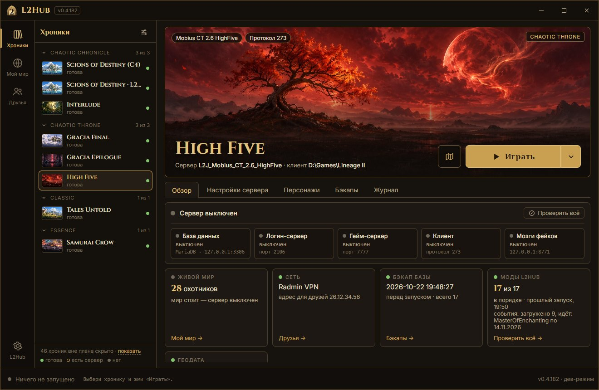
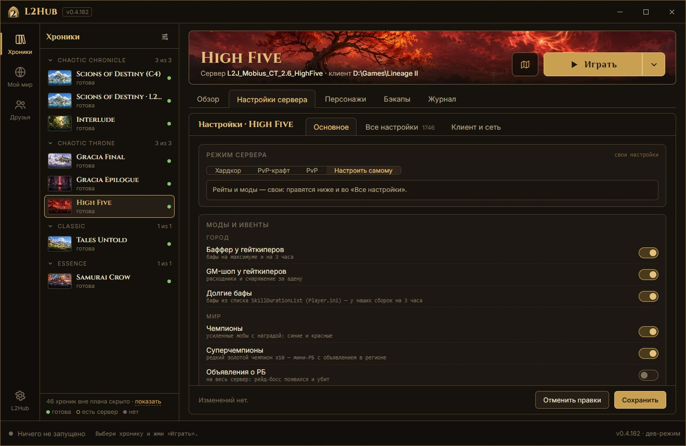
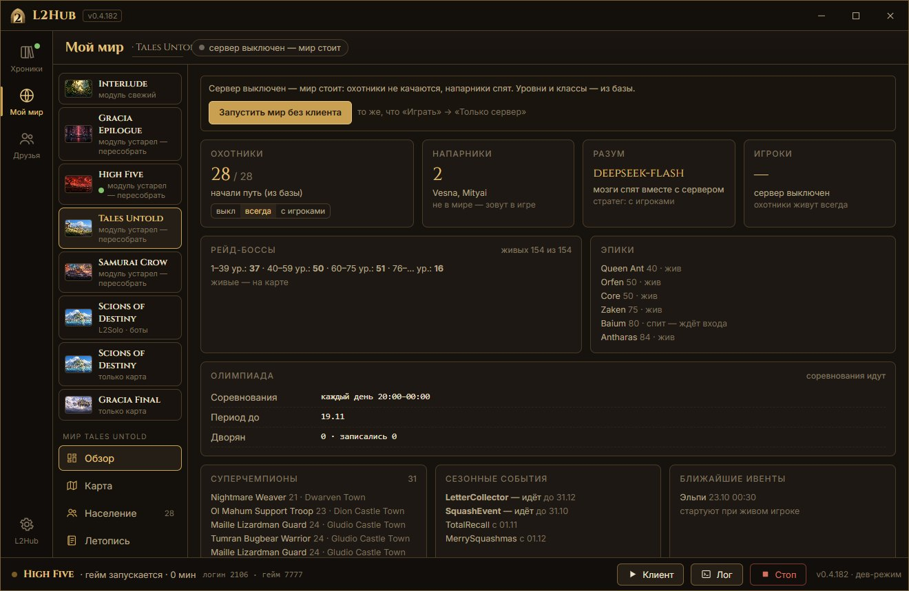

# L2Hub

**Русский** · [English](README.en.md)

**L2Hub — свой сервер Lineage II у тебя на компьютере, одной кнопкой.** Выбрал хронику, нажал «Установить», потом «Играть»: L2Hub сам скачает сервер, соберёт его, поднимет базу и запустит твой клиент. Играть можно одному в живом мире или с друзьями.

> **Дисклеймер.** L2Hub — фанатский инструмент для локальной игры. Он не связан с NCSoft, не содержит и не раздаёт клиенты игры и файлы NCSoft, не поднимает публичных серверов и ничего не продаёт. Lineage II и названия хроник — товарные знаки NCSoft Corporation.

## Что внутри

- **Хроники одной кнопкой.** Interlude, Gracia Epilogue, High Five, Classic (Tales Untold), Essence (Samurai Crow) — сервер [L2J Mobius](https://gitlab.com/MobiusDevelopment/L2J_Mobius) с нашими модами; C4 — [L2Solo](https://github.com/pmbstyle/L2Solo) с 1700 ботами. Ещё три десятка хроник Mobius ставятся «как есть», без модов. Свою сборку (L2J на Java или комбайн со своей базой) можно подключить.
- **Живой мир для одного.** Охотники-фантомы растут вместе с тобой: качаются на спотах, собирают пати, торгуют в Гиране, ходят в рейды на боссов, на PvP-ивенты, на олимпиаду и за Семь печатей, вызывают на дуэль. Напарники идут с тобой в пати (`.buddy`). Говорить с ботами можно по-настоящему — «мозги» на LLM, если подключишь свой ключ (DeepSeek или любой OpenAI-совместимый API) или свою модель (LM Studio, Ollama).
- **Моды для соло.** Баффер и GM-шоп у гейткиперов, чемпионы и редкие суперчемпионы, поручения дня (`.daily`), сезонные события по календарю круглый год, «Мир сейчас» (`.world`) и доска Alt+B. Олимпиада, Семь печатей и эпики — «малого мира»: им хватает одного игрока и охотников. Каждый мод выключается.
- **Режимы сервера.** «Хардкор» (x1, как на официале, без удобств), «PvP-крафт», «PvP» или «Настроить самому» — все конфиги сервера с описаниями.

  

- **«Мой мир».** Кто из охотников где и чем занят, рейд-боссы и эпики, олимпиада, суперчемпионы, ближайшие события, летопись мира — без входа в игру.

  

- **С друзьями.** Radmin VPN, Tailscale, ZeroTier или локальная сеть: L2Hub пропишет адреса и соберёт другу клиент или `L2.ini`.
- **Бэкапы базы** перед каждым запуском и откат в два клика. **«Проверить всё»** — что сломалось и как починить.
- **Интерфейс на русском и английском** («L2Hub» → «Язык интерфейса»).

## Что нужно

- Windows 10 или 11 (64-бит), от 16 ГБ памяти, 5–10 ГБ на диске на каждую хронику.
- **Клиент игры — свой.** L2Hub клиентов не раздаёт и ссылок на них не даёт. Нужен клиент той же хроники и сборки, что и сервер (протокол — в карточке хроники). Для Classic и Essence подходит официальный клиент 4game нужной сборки: L2Hub запускает его с отдельным ini на твой компьютер, ничего в клиенте не меняя. Для Interlude, Epilogue и High Five нужна система клиента под приватные серверы. Для C4 — клиент L2Solo (ссылка на их раздачу — в окне установки).
- Java, MariaDB, исходники сервера и геодату L2Hub скачивает сам, из официальных источников и со сверкой контрольных сумм. Окну нужен Microsoft Edge WebView2 Runtime: в Windows 11 он есть всегда, в Windows 10 установщик подскажет.

## Установка

1. Скачай `L2Hub-<версия>-setup.exe` со [страницы релизов](https://github.com/kraffty4/L2Hub/releases). Программа не подписана: Windows может показать «Windows защитила ваш компьютер» — «Подробнее» → «Выполнить в любом случае». Суммы файлов — в `SHA256SUMS.txt` релиза.
2. Установщик ставит L2Hub для текущего пользователя, без прав администратора, и спрашивает папку данных: только латиница, без пробелов, например `C:\L2Hub`. Там будут серверы, базы и бэкапы — от 5 ГБ. Есть и портативный zip: данные — рядом с программой.
3. Открой L2Hub, выбери хронику и нажми «Установить». Сервер собирается несколько минут.
4. Укажи папку клиента — ссылка «указать» в шапке хроники: L2Hub сам поищет клиенты на дисках.
5. «Играть». Логин и пароль — любые новые: аккаунт создастся при первом входе.

Обновления L2Hub проверяет сам и ставит по кнопке. Баги и идеи — в [Issues](https://github.com/kraffty4/L2Hub/issues) или кнопкой «Отзыв» в окне. Не хватает хроники — нажми «Хочу эту хронику» в её карточке: первой доведём до ума ту, за которую больше голосов.

## Чего L2Hub не делает

- Не раздаёт клиенты, системы приватных серверов и прочие файлы NCSoft.
- Не поднимает публичных серверов и ничего не продаёт.
- Не трогает твой клиент без спроса: настройки и русский язык для клиентов 4game — в отдельных копиях файлов.

## Из исходников

Python 3.12 и [uv](https://docs.astral.sh/uv/): `cd launcher`, `uv sync`, `uv run python -m l2hub`. Устройство проекта и правила — [AGENTS.md](AGENTS.md), план — [docs/PLAN.md](docs/PLAN.md), сборка exe и установщика — [docs/RELEASE.md](docs/RELEASE.md).

## Лицензии и спасибо

L2Hub — [GPL-3.0](LICENSE). Чужие компоненты и их лицензии — в [THIRD_PARTY.md](THIRD_PARTY.md). Спасибо [L2J Mobius](https://gitlab.com/MobiusDevelopment/L2J_Mobius), [L2Solo](https://github.com/pmbstyle/L2Solo), L2J Geodata, [l2mapconv](https://github.com/m49n/l2mapconv-public) и [l2-world-map](https://github.com/npetrovski/l2-world-map).
